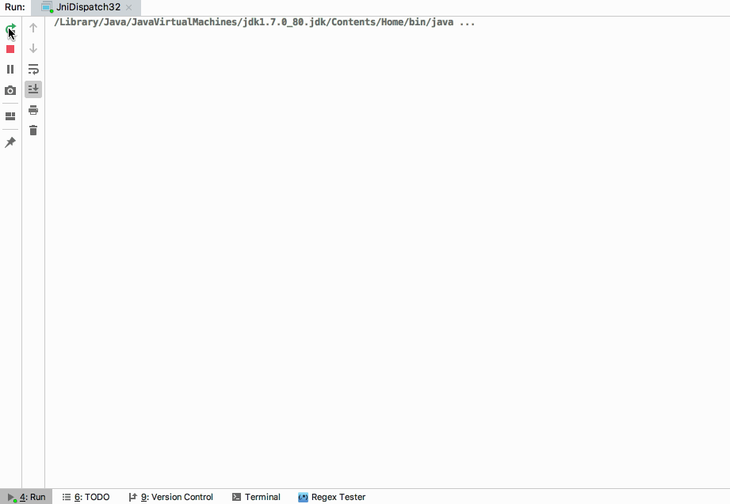
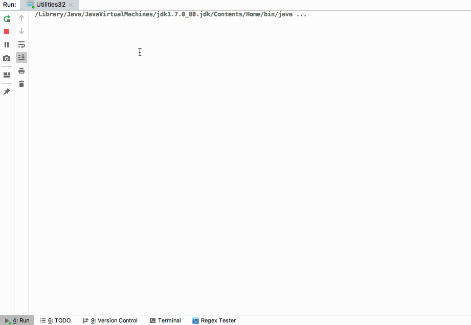
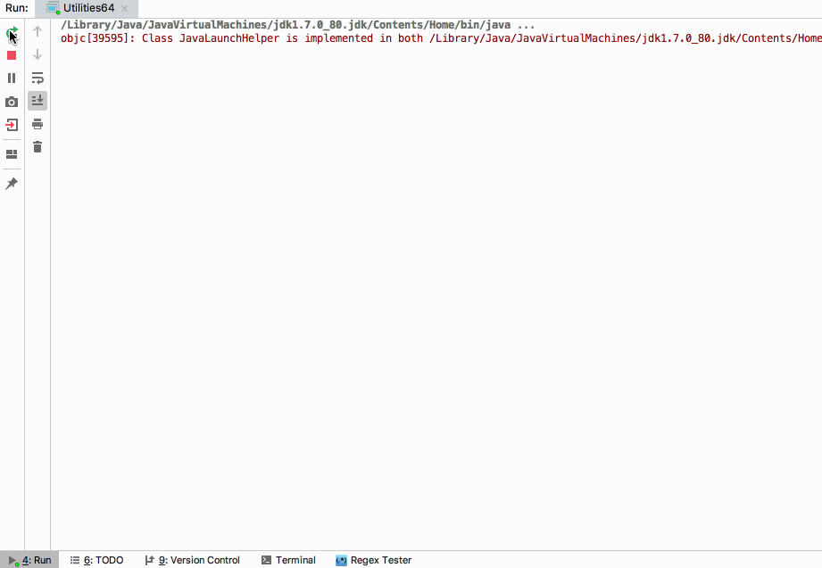

# unidbg-kitty

**A fork of [unidbg](https://github.com/zhkl0228/unidbg) that stops the emulator from giving itself away — and makes your hooks actually fire.**

> **包含七神（metasec）的完整补环境例子 / A complete worked environment for the "seven gods" (metasec) hardening library.**
>
> 仓库自带一个可运行的完整例子（[`MetasecDemo`](unidbg-android/src/test/java/com/bytedance/mobsec/metasec/ml/MetasecDemo.java)，详见
> [下文](#the-example-a-hardened-library-brought-up-and-called)）：把一个商业加固库在模拟器里完整拉起来，并逐个调用它各个
> native 入口。设备值全部来自外部 profile，源码里不内置任何设备指纹。
>
> **微信 / WeChat：`klovemh3344`** — 学术交流、技术讨论欢迎来找我。
> Added purely for academic exchange and technical discussion — questions about the emulation
> and fidelity work are welcome.

You know the two bad afternoons.

The first: you set a hook, or patch an instruction, and *nothing happens*. No error, no warning. The callback never fires, the patch never takes, and you spend hours doubting your address arithmetic — because the engine was quietly re-running a translation it cached before your hook existed.

The second: everything runs, and the target still knows. `CurrentEL` reads 4 where hardware says 0. An `MRS` on a privileged system register quietly succeeds where a phone delivers SIGILL. A `SIGSEGV` handler never runs. A thread signals itself and spins forever. `clock_gettime` and `CNTVCT_EL0` disagree, because one is the host wall clock and the other was never wired to anything. Hardened libraries read exactly these things.

Nothing here is device-specific. Every value reported to the guest is read from the backend's own CPU model and then processed by Linux kernel and ARM architecture rules — no device profile is baked in, so the fingerprint stays yours to supply. User-visible behaviour is checked by NDK-built probes running real bionic inside the emulator; the engine fixes are checked against expected semantics and regression-tested. Each change was developed as its own commit against its own notes; the shorthand `diff-01` to `diff-11` below refers to those, and the measurements quoted come from them.

> **No existing upstream API changes signature or behaviour, and the default backend is byte-for-byte unchanged.** All of this rides on the opt-in `unicorn2` backend. Don't ask for it, get stock unidbg — including every bug listed below. The only additions are opt-in: the `SysRegBackend` / `SignalDeliverer` / `DispatcherHooks` interfaces that only this backend implements, `ThreadDispatcher#runThreadsUntilIdle()`, and two chainable `Unicorn2Factory` setters.

```java
AndroidEmulator emulator = AndroidEmulatorBuilder.for64Bit()
        .addBackendFactory(new Unicorn2Factory(false))   // opt in
        .build();
```

## What's fixed

**Your hooks and patches take effect.** Read this one. Patch code after it has run, add a code/block/read hook, set a breakpoint, unmap and remap — upstream silently kept executing the **old translation**. No error. Your callback never fires, your patch never takes. It is upstream engine design, present in official unicorn 2.1.4 too, and it reproduces every time, because unidbg's calls always stop at a return address outside the code under test. Even upstream's own `SignalTest` trace gained 139 lines once this was fixed — 105 of them PLT stubs it had never recorded. `LateChangeTest`: **7 of 10 failing before, 10 of 10 after**. Invalidation is now automatic, zero cost on already-cached code; adding a global hook re-translates what is cached, so toggling `traceCode` per call is no longer free (6 ms to roughly 500 ms for 200k blocks). (diff-07)

**EL0 privilege boundary.** `MRS`/`MSR`/`SYS`/`SYSL` all reach a hook across the whole encoding space, MSR immediates included. ID registers answer with the user-space view the kernel traps and emulates. The EL0 whitelist is answered in native from a passthrough bitmap and never crosses JNI — `mrs tpidr_el0` costs 9 ns a read instead of the 264 ns a round-trip to Java costs, against 2 ns for the same read with no hook at all. Everything else raises SIGILL. `ERET`, `HVC` and `SMC` are undefined at EL0: the engine happens to execute in EL1, but the guest is user code and should never be able to tell. PAC genuinely signs (on by default; `setPointerAuthentication(false)` reports a core without PAuth consistently across the ID registers and `AT_HWCAP`). SVE is usable — upstream unicorn ships without `arm_cpu_sve_finalize`, so the vector-length map is empty and enabling SVE trips an assertion. The rewritten 101-case matrix passes clean; the 61-case suite it replaced failed 40. `El0BoundaryE2ETest` against real bionic: **56/56**. (diff-01)

**Signals that behave like signals.** Delivery pushes a kernel-layout `rt_sigframe` onto the interrupted thread's *own* stack, runs the handler in that same task, and returns through `rt_sigreturn`. That one structural decision is what makes `siglongjmp` out of a handler work, makes rewriting `uc_mcontext.pc` take effect, makes nested faults behave, and makes `sa_mask` mean what bionic meant by it — upstream's `SigAction64` lays out `mask` where the kernel puts `sa_restorer`, so bionic's `sa_mask` was read as a restorer address. The kernel model reads the struct at kernel offsets instead and the class itself is left byte-identical, so other backends are untouched. And a thread can finally signal itself: with the dispatcher off (the common default) upstream dropped `tgkill`-to-self entirely, the handler never ran, and `TgkillSelfTest` busy-waits **20 million iterations** before giving up — real code just hangs. Here the handler completes before `tgkill` returns, zero spins, dispatcher on or off. `SignalFidelityE2ETest`: **35/35 single-threaded, 8/8 threaded**, plus a 100,000-round stress pass at exactly the expected 125,001 handler entries, with stack and mask unchanged. (diff-02)

**A clock that belongs to the guest.** `CNTVCT_EL0`, `clock_gettime` and `gettimeofday` read **one** clock, advanced by instructions actually executed (a fixed 0.5 ns each — a constant, not a calibrated figure) plus the time the guest spends waiting. Not two clocks that can be compared and found inconsistent — one. Sleep the host thread 300 ms inside a callback and the guest sees **17 ns** pass, not 315 ms; 51 ns between calls, not 305 ms. Two emulators computing the same thing read bit-identical. `select` on an empty pipe with a 40 ms timeout took 1016 ms and now takes 40 ms. `VirtualClockE2ETest`: **23/23**, 15 of them failing before. Silent, because it is a time source the framework was always synthesizing anyway — and your overrides still win: fix `currentTimeMillis()` and `CLOCK_REALTIME` is exactly that value, every time. Instruction counting costs about 11% in the worst case measured, a hot loop of three-instruction blocks. (diff-04)

**Memory faults you can catch.** Emulation stops *at* the faulting instruction rather than at the head of its translation block, with the destination register and base writeback untouched, and `mprotect` now flushes stale TLB entries and invalidates translations for pages that lost execute permission. Both of those apply whether or not you opt in. Then `new Unicorn2Factory(false).setMemoryFaultSignals(true)` — the `false` is the usual `fallbackUnicorn` flag, unrelated to faults — and a real `SIGSEGV` arrives with `SEGV_MAPERR`/`ACCERR`, `si_addr` equal to `fault_address`, and a populated esr_context: for `sigsetjmp` probes, `PROT_NONE` traps, packers that repair a mapping and retry. `MemoryFaultE2ETest` 19/19, down to exact ESR values (`0x9200004f` for a store to `PROT_NONE`). Default keeps upstream's `Read memory failed` WARN, because in unidbg an invalid access usually means your environment is missing something and that warning is the most useful thing on screen — with the switch off and a handler installed, you get one extra line telling you the switch exists. (diff-03)

**Threads that wait on guest time.** With the thread dispatcher enabled (still opt-in, as upstream has it), futex timeouts, `nanosleep` and `rt_sigtimedwait` settle on the guest clock. Emulation runs roughly 70x slower than hardware, so 21 ms of guest work used to blow a one-second deadline and come back `ETIMEDOUT` — the worker measured 1007 ms. A guest sleeping one second alongside a 100 ms timer thread now sees 9 ticks and costs the host 9 ms, and the same run gives 9 again. When every thread is waiting on a deadline, the clock advances to the earliest one instead of the host idling; when every wait is indefinite it still waits, as upstream does, but says once which thread is stuck on what. Forty threads in one call all run — upstream threw `Threads is too much` at the 17th, because finished threads did not release their stack slot until the call returned. Plus `runThreadsUntilIdle()`, which replaces guessing a duration, and CPU state restored after background threads run. (diff-05)

**Windows heap corruption, in the engine.** MinGW builds compile `oslib-posix.c`, where `qemu_try_memalign` uses `__mingw_aligned_malloc` on the CRT heap but `qemu_vfree` calls `VirtualFree(MEM_RELEASE)`. For a 512 KB allocation that release *succeeds*, handing the CRT's own region back to the OS behind the heap's back — and the translation-block hash table's initial bucket array is exactly 512 KB. 36 `hs_err` files across three crash sites: table resize, repeated `close()`, and resize after a close. Upstream's own fix, ported, along with a second instance of the same mis-pairing in `uc_close`'s bounce buffer. `EngineHeapStressTest` goes from crash to pass. (diff-06)

**Nothing that didn't happen looks like success.** An unimplemented syscall used to leave `x0` unwritten, so the guest read back whatever was there — usually the first argument — and treated it as a return value. `process_vm_readv` "succeeded" 142 times in one run by returning a pid. Now unimplemented syscalls return `-ENOSYS`, with the original WARN and debugger entry untouched. Implemented where the answer was already in hand: `dup`, `fsync`, `getgid`/`getegid`, `process_vm_readv` (own process only, routed so `setTraceSystemMemoryWrite` still sees it), `openat`/`fstatat`/`faccessat` with a real directory fd, `clock()`, `CLOCK_PROCESS_CPUTIME_ID`, `CLOCK_REALTIME_COARSE`, `FUTEX_WAIT_BITSET`. `readlink` honours `bufsiz` — upstream ignored it and wrote the whole path plus a NUL whatever the caller asked for, so a 22-byte path wrote 23 bytes into a 4-byte buffer and returned 23, clobbering the guest's stack buffer. Nest a call inside a hook and the nested call raises the `IllegalStateException("running")` it always did, but the outer call now stops cleanly at the nesting point instead of throwing a `ConcurrentModificationException` that buried the real error and left two dead tasks in the queue. A missing path still fails and a decoy at the rootfs root is still not found. Your `handleUnknownSyscall` still gets first refusal. (diff-08, diff-09, diff-10, diff-11)

## Not landed yet

More is finished than is merged. Time, not capability. But these are genuinely open:

- **Engine-level `UC_HOOK_CODE_FAST`.** [`FastTracer`](unidbg-api/src/main/java/com/github/unidbg/arm/FastTracer.java) already beats unidbg's existing `AssemblyCodeDumper` by a wide margin in pure Java — zero register read-back, an L1 disassembly cache keyed by address, a 64 KB buffer flushed every 8192 entries. The prize left is in the JIT: a per-instruction callback with the register snapshot inlined into translated code. Done that way the callback stops being a JNI round trip per instruction, and the order of magnitude that buys is the point of the exercise — a related engine of ours reaches roughly 10x on a lazy-read variant of the design, which is the figure to beat rather than one to quote for this branch. The JIT codegen patches apply cleanly here; the hook-slot plumbing conflicts and needs hand-placing. The benchmark that would put a real number on it is part of the same unlanded work.
- **macOS.** The committed `libunicorn.dylib` files for `osx_64` and `osx_arm64` are still upstream's and carry none of these engine changes. On macOS the backend warns once at creation and the EL0 boundary, PAC setup, the CPU-feature view and the virtual clock stay off — you silently get close to stock behaviour even if you do ask for `unicorn2`. The signal model is pure Java and still works. Rebuilding needs a Mac. Linux x64/arm64 and Windows x64 are built from the fork and shipped.
- **iOS-side integration** of the EL0 and signal work.
- **Known residual limits**, all deliberate: the dispatcher stays cooperative, so a spin loop with no syscall never sees another thread unless you enable preemption via `registerEmuCountHook` (nearly free now on the fork engine); `SA_RESTART` is unimplemented, so interrupted waits always return `-EINTR`; no timer-driven signals (`setitimer`/`timer_create` SIGALRM, SIGCHLD); SIGBUS is not modelled; syscalls given bad guest pointers do not return `-EFAULT`; `sve_context` is written as "not in SVE state"; and 32-bit gets none of this. One deliberate exception to "default backend unchanged": the `/proc/<pid>/fd/` `NumberFormatException` in `resolve()` was an accidental crash, so that fix applies to every backend.

## Engine

The engine lives in its own repository: **[GitKittys/unicorn-kitty](https://github.com/GitKittys/unicorn-kitty/tree/unidbg), branch `unidbg`** — a fork of [zhkl0228/unicorn](https://github.com/zhkl0228/unicorn) `unicorn2` carrying the engine-side changes described above. It is kept separate so that cloning unidbg does not drag the whole QEMU tree with it, and no QEMU source is vendored here.

**You do not need it to use this project.** Prebuilt `libunicorn` natives for Linux x64/arm64 and Windows x64 are committed, so a plain clone builds and runs:

```bash
git clone https://github.com/GitKittys/unidbg-kitty
cd unidbg-kitty
./mvnw -pl unidbg-api,unidbg-android,backend/unicorn2 -am package     # JDK 8
```

`backend/unicorn2` is the opt-in backend everything above rides on, and it carries the prebuilt natives, so build it alongside `unidbg-android` and add it to your dependencies.

**You need it only to rebuild the engine itself.** The build script fetches it for you on first use — nothing to clone by hand:

```bash
cd backend/unicorn2/src/main/native
bash build.sh            # clones unicorn-kitty@unidbg into ~/git/unicorn, then builds
```

It is a plain `git clone`, not a submodule, so `--recursive` neither helps nor hurts. Override any of it through the environment: `UNICORN_REPO`, `UNICORN_BRANCH`, and `UNICORN_HOME` (point the last at a checkout you already have). The script verifies the checkout really is this fork before building and stops with the exact clone command if it is not, so you never silently link against upstream unicorn. Docker supplies the Linux and Windows toolchains; the macOS dylibs still need a Mac and are currently upstream's, as noted above.

## The example: a hardened library, brought up and called

`MetasecDemo` under `unidbg-android/src/test/java/com/bytedance/mobsec/metasec/ml/` is one entry point for the whole thing. It brings a commercial Android hardening library up from a recorded profile and then exercises each of its distinct native call sites:

```bash
java ... MetasecDemo            # every demo below, then the mssdk channel as a dry run
java ... MetasecDemo http       # the HTTP request sign: seven headers at once
java ... MetasecDemo ws         # the WebSocket sign: a different call site, X-Cylons alone
java ... MetasecDemo both       # the same input through both entries, side by side
java ... MetasecDemo ttencrypt  # the applog / device_register body envelope
java ... MetasecDemo mssdk      # the report channel (dry run; --live to actually send)
```

Nothing reaches the network unless you ask: the signing happens inside the emulator, and `mssdk` only sends with `--live`. It is the clearest demonstration of what the fidelity work above buys — a library that checks where it is running, running anyway.

The device is data, never code: every value comes from an external profile (`-Dmetasec.profile`, read through `DeviceProfile`), so no device is baked into the source. What you supply yourself:

- **The libraries.** `libmetasec_ml.so` and its companions live under the rootfs at `data/app/<install>/lib/arm64/`. Offsets in `device/metasec.json` are matched to one build of them.
- **Files that are placeholders here.** The ROM libraries and the APK slices are stand-ins of the right size — the emulation only stats them, never parses their bytes, so the size is all that is load-bearing. Each one says so in its first line. Drop your own copies at the same paths to run against the real thing.
- **Credentials that are simply absent.** A placeholder is only honest where the bytes are never read, so nothing stands in for a certificate: the app signing certificate and the AndroidKeyStore attestation chain are left out rather than faked. "No attestation chain" is the real state of a device with no Google Mobile Services, and it is the measured client behaviour — given no chain, the client retries three times 30 s apart and then omits the one request that needs it, with the rest of the flow unaffected. A self-signed chain is worse than none, being rejected as an attempt to fake hardware attestation. Supply a real one from outside if you need that branch: [`device/keystore/README.md`](unidbg-android/src/test/resources/example_binaries/metasec/device/keystore/README.md).

## Also here: replay instead of environment-building

[`unidbg-dump-replay`](unidbg-dump-replay/) takes a snapshot of a native execution that *already happened on a real device* — memory segments, entry registers, external symbol table, JNI function table, `/proc/self/maps`, and every file the target opened — refills it inside unidbg and keeps running. No reimplementing the algorithm as a reference answer, no day of stubbing JNI and faking system properties: the scene already happened on hardware, and you continue it. It works through the low-level `mem_map`/`mem_write`/`reg_write`/`emu_start`/`addBreakPoint` interfaces rather than the Module/Loader/DalvikVM stack, reaching for `Memory.dlopen` only to get a real libc symbol table to patch external calls against. Capture it in one call with [AndroidPrybar](https://github.com/GitKittys/AndroidPrybar/).

---

Everything below is upstream's README, unchanged.

# unidbg

Allows you to emulate an Android native library, and an experimental iOS emulation.

This is an educational project to learn more about the ELF/MachO file format and ARM assembly.

Use it at your own risk !

## Features
- Support [MCP (Model Context Protocol)](https://modelcontextprotocol.io/) for AI-assisted debugging with Cursor and other AI tools.
- Emulation of the JNI Invocation API so JNI_OnLoad can be called.
- Support JavaVM, JNIEnv.
- Emulation of syscalls instruction.
- Support ARM32 and ARM64.
- Inline hook, thanks to [Dobby](https://github.com/jmpews/Dobby).
- Android import hook, thanks to [xHook](https://github.com/iqiyi/xHook).
- iOS [fishhook](https://github.com/facebook/fishhook) and substrate and [whale](https://github.com/asLody/whale) hook.
- [unicorn](https://github.com/zhkl0228/unicorn) backend support simple console debugger, gdb stub, instruction trace, memory read/write trace.
- Support iOS objc and swift runtime.
- Support [dynarmic](https://github.com/MerryMage/dynarmic) fast backend.
- Support Apple M1 hypervisor, the fastest ARM64 backend.
- Support Linux KVM backend with Raspberry Pi B4.
- Memory leak detection for emulated native code with guest backtrace and host stack trace.

## MCP Debugger (AI Integration)

unidbg supports [Model Context Protocol (MCP)](https://modelcontextprotocol.io/) for AI-assisted debugging. When the debugger is active, type `mcp` in the console to start an MCP server that AI tools (e.g. Cursor) can connect to.

### Quick Start

unidbg MCP has two operating modes:

**Mode 1: Breakpoint Debug** — Attach the debugger and run your code. When a breakpoint is hit, `Breaker.debug()` pauses the emulator — type `mcp` in the console to start MCP server and let AI assist with analysis. All debugging tools are available (registers, memory, disassembly, stepping, tracing, etc). After resuming, if another breakpoint is hit the debugger pauses again. Once execution completes without hitting a breakpoint, the process exits and MCP shuts down.

```java
Debugger debugger = emulator.attach();
debugger.addBreakPoint(address);
// run your emulation logic — debugger pauses when breakpoint is hit
```

**Mode 2: Custom Tools (Repeatable)** — Use `McpToolkit` to register custom tools and let AI re-run target functions with different parameters. The native library is loaded once; after each execution the process stays alive and MCP remains active for the next run.

```java
McpToolkit toolkit = new McpToolkit();
toolkit.addTool(new McpTool() {
    @Override public String name() { return "encrypt"; }
    @Override public String description() { return "Run encryption"; }
    @Override public String[] paramNames() { return new String[]{"input"}; }
    @Override public void execute(String[] params) {
        String input = params.length > 0 ? params[0] : "default";
        // call encryption with input
    }
});
toolkit.run(emulator.attach());
```

When the debugger breaks, type `mcp` (or `mcp 9239` to specify port) in the console. Then add to Cursor MCP settings:

```json
{
  "mcpServers": {
    "unidbg-mcp-server": {
      "url": "http://localhost:9239/sse"
    }
  }
}
```

### Available MCP Tools

**Status & Info**

| Tool | Description |
|------|-------------|
| `check_connection` | Emulator status: Family, architecture, backend capabilities, isRunning, loaded modules |
| `list_modules` / `get_module_info` | List loaded modules, get detail including exported symbol count and dependencies |
| `list_exports` | List exported/dynamic symbols of a module with optional filter and C++ demangling |
| `find_symbol` | Find symbol by name or find nearest symbol at address |
| `get_threads` | List all threads/tasks in the emulator |

**Registers & Disassembly**

| Tool | Description |
|------|-------------|
| `get_registers` / `get_register` / `set_register` | Read/write CPU registers |
| `disassemble` | Disassemble instructions at address (branch targets auto-annotated with symbol names) |
| `assemble` | Assemble instruction text to machine code |
| `get_callstack` | Get current call stack (backtrace) |

**Memory**

| Tool | Description |
|------|-------------|
| `read_memory` / `write_memory` | Read/write raw memory bytes |
| `read_string` / `read_std_string` | Read C string or C++ std::string (with SSO detection) |
| `read_pointer` | Read pointer chain with symbol resolution |
| `read_typed` | Read memory as typed values (int8–int64, float, double, pointer) |
| `search_memory` | Search memory for byte patterns with scope/permission filters |
| `list_memory_map` | List all memory mappings with permissions |
| `allocate_memory` / `free_memory` / `list_allocations` | Allocate (malloc/mmap) with optional initial data, free, and track memory blocks |
| `patch` | Write assembled instructions to memory |

**Breakpoints & Execution**

| Tool | Description |
|------|-------------|
| `add_breakpoint` / `add_breakpoint_by_symbol` / `add_breakpoint_by_offset` | Add breakpoints by address, symbol, or module+offset |
| `remove_breakpoint` / `list_breakpoints` | Remove or list breakpoints (with disassembly) |
| `continue_execution` | Resume execution. Use poll_events to wait for breakpoint_hit or execution_completed |
| `step_over` / `step_into` / `step_out` | Step over, into (N instructions), or out of function |
| `next_block` | Break at next basic block (Unicorn only) |
| `step_until_mnemonic` | Break at next instruction matching mnemonic, e.g. `bl`, `ret` (Unicorn only) |
| `poll_events` | Poll for breakpoint_hit, execution_completed, trace events |

**Tracing**

| Tool | Description |
|------|-------------|
| `trace_code` | Trace instructions with register read/write values (regs_read, prev_write) |
| `trace_read` / `trace_write` | Trace memory reads/writes in address range |

**Function Calls**

| Tool | Description |
|------|-------------|
| `call_function` | Call native function by address with typed arguments (hex, string, bytes, null). Returns value with symbol resolution and memory preview |
| `call_symbol` | Call exported function by module + symbol name, e.g. `libc.so` + `malloc` |

**iOS Only** (available when Family=iOS)

| Tool | Description |
|------|-------------|
| `inspect_objc_msg` | Inspect objc_msgSend call: show receiver class name and selector, e.g. `-[NSString length]` |
| `get_objc_class_name` | Get ObjC class name of an object at a given address (pure memory parsing, no state change) |
| `dump_objc_class` | Dump ObjC class definition (properties, methods, protocols, ivars) |
| `dump_gpb_protobuf` | Dump GPB protobuf message schema as .proto format (64-bit only) |

### Custom MCP Tools

Use `McpToolkit` to register custom tools, each implementing the `McpTool` interface. This replaces manual if-else dispatch with clean, self-contained tool classes. By this point the native library is fully loaded (JNI_OnLoad / entry point already executed), so the code inside each tool's `execute()` is the target function logic to analyze. AI can set breakpoints and traces before triggering a custom tool, then inspect execution results across different inputs without restarting the process.

**Android Example** — See [Utilities64.java](https://github.com/zhkl0228/unidbg/blob/master/unidbg-android/src/test/java/org/telegram/messenger/Utilities64.java) for an Android JNI example with custom MCP tools:

```java
DalvikModule dm = vm.loadLibrary(new File("libtmessages.29.so"), true);
dm.callJNI_OnLoad(emulator);
cUtilities = vm.resolveClass("org/telegram/messenger/Utilities");

McpToolkit toolkit = new McpToolkit();
toolkit.addTool(new McpTool() {
    @Override public String name() { return "aesCbc"; }
    @Override public String description() { return "Run AES-CBC encryption on input data"; }
    @Override public String[] paramNames() { return new String[]{"input"}; }
    @Override public void execute(String[] params) {
        byte[] input = params.length > 0 ? params[0].getBytes() : new byte[16];
        aesCbcEncryptionByteArray(input);
    }
});
toolkit.addTool(new McpTool() {
    @Override public String name() { return "aesCtr"; }
    @Override public String description() { return "Run AES-CTR decryption on input data"; }
    @Override public String[] paramNames() { return new String[]{"input"}; }
    @Override public void execute(String[] params) {
        byte[] input = params.length > 0 ? params[0].getBytes() : new byte[16];
        aesCtrDecryptionByteArray(input);
    }
});
toolkit.addTool(new McpTool() {
    @Override public String name() { return "pbkdf2"; }
    @Override public String description() { return "Run PBKDF2 key derivation"; }
    @Override public String[] paramNames() { return new String[]{"password", "iterations"}; }
    @Override public void execute(String[] params) {
        String password = params.length > 0 ? params[0] : "123456";
        int iterations = params.length > 1 ? Integer.parseInt(params[1]) : 100000;
        pbkdf2(password.getBytes(), iterations);
    }
});
toolkit.run(emulator.attach());
```

**iOS Example** — See [IpaLoaderTest.java](https://github.com/zhkl0228/unidbg/blob/master/unidbg-ios/src/test/java/com/github/unidbg/ios/IpaLoaderTest.java) for an iOS IPA loading example with custom MCP tools:

```java
IpaLoader ipaLoader = new IpaLoader64(ipa, new File("target/rootfs/ipa"));
LoadedIpa loader = ipaLoader.load(this);
emulator = loader.getEmulator();
loader.callEntry();
module = loader.getExecutable();

McpToolkit toolkit = new McpToolkit();
toolkit.addTool(new McpTool() {
    @Override public String name() { return "dumpClass"; }
    @Override public String description() { return "Dump an ObjC class definition by name"; }
    @Override public String[] paramNames() { return new String[]{"className"}; }
    @Override public void execute(String[] params) {
        String className = params.length > 0 ? params[0] : "AppDelegate";
        IClassDumper classDumper = ClassDumper.getInstance(emulator);
        System.out.println("dumpClass(" + className + "):\n" + classDumper.dumpClass(className));
    }
});
toolkit.addTool(new McpTool() {
    @Override public String name() { return "readVersion"; }
    @Override public String description() { return "Read the TelegramCoreVersionString from the executable"; }
    @Override public void execute(String[] params) {
        Symbol sym = module.findSymbolByName("_TelegramCoreVersionString");
        if (sym != null) {
            Pointer pointer = UnidbgPointer.pointer(emulator, sym.getAddress());
            if (pointer != null) {
                System.out.println("_TelegramCoreVersionString=" + pointer.getString(0));
            }
        }
    }
});
toolkit.run(emulator.attach());
```

Once the MCP server is started, AI can call these tools via MCP to run emulations with custom parameters, set breakpoints, trace execution, and inspect results — all without restarting the process.

> **Low-level API**: You can also use `Debugger.addMcpTool()` + `Debugger.run(DebugRunnable)` directly for full control. `McpToolkit` is a higher-level wrapper that eliminates if-else dispatch.

## Memory Leak Detection

Track guest-side memory allocations (mmap/munmap/brk) to detect leaks in emulated native code. Use `try-with-resources` — tracking starts on creation, and the leak report is printed automatically on close.

```java
try (MemoryTracker tracker = emulator.traceMemoryLeaks()) {
    module.callFunction(emulator, "targetFunction", arg1, arg2);
}
```

Each leaked block includes guest ARM backtrace (module+offset+symbol) and host Java stack trace. Sample output:

```
=== Memory Leak Report ===
Tracking duration: 42ms
Total allocations: 5
Total deallocations: 3
Leaked blocks: 2
Total leaked size: 32768 bytes (32.0 KB)

--- Leak #1 ---
Address: 0x40001000, Size: 16384 (16.0 KB), Perms: rw-
Guest Backtrace:
  #0 0x40123456 libexample.so+0x3456 (malloc+0x12)
  #1 0x40124000 libexample.so+0x4000 (doSomething+0x48)
Host Stack Trace:
  com.github.unidbg.linux.AndroidElfLoader.mmap2(AndroidElfLoader.java:785)
  ...
```

You can also access the report programmatically before close:

```java
try (MemoryTracker tracker = emulator.traceMemoryLeaks()) {
    module.callFunction(emulator, "targetFunction", arg1, arg2);
    List<AllocationRecord> leaks = tracker.getLeaks();
    assert leaks.isEmpty() : "Memory leak detected!";
}
```

## Worker Pool

A thread-safe object pool for reusing emulator instances across multiple threads, avoiding the overhead of repeated initialization.

- **Lazy initialization** — Workers are created on-demand only when the pool is empty, not upfront.
- **Max limit** — Total alive workers (borrowed + idle) never exceeds the configured maximum.
- **Idle cleanup** — Workers idle for longer than the timeout (default 10 minutes) are automatically destroyed by the management thread.
- **Min idle** — A minimum number of workers (default 1) is always kept alive, even when idle.

### 1. Implement a Worker

```java
public class MyWorker implements Worker {
    private final AndroidEmulator emulator;

    public MyWorker() {
        emulator = AndroidEmulatorBuilder.for64Bit().build();
        // load .so, call JNI_OnLoad, etc.
    }

    @Override
    public void destroy() {
        emulator.close();
    }

    public byte[] doWork(byte[] input) {
        // call native methods and return the result
    }
}
```

### 2. Create Pool, Borrow, and Close

```java
// Create a worker pool (max = CPU cores, lazy-initialized)
WorkerPool pool = WorkerPoolFactory.create(MyWorker::new);
// Or specify max workers explicitly
// WorkerPool pool = WorkerPoolFactory.create(MyWorker::new, 4);

// Optional: customize idle timeout (default 10 minutes, minimum 1 minute)
pool.setIdleTimeout(30); // idle workers destroyed after 30 minutes
// Optional: customize minimum kept-alive workers (default 1, minimum 1)
pool.setMinIdle(2); // always keep at least 2 workers alive
// Optional: pre-create workers eagerly (default 0, fully lazy)
pool.setInitialSize(4); // eagerly create 4 workers on startup

// Concurrent invocation from multiple threads
ExecutorService executor = Executors.newFixedThreadPool(100);
for (int i = 0; i < 100; i++) {
    executor.submit(() -> {
        try (WorkerLoan<MyWorker> loan = pool.borrow(1, TimeUnit.MINUTES)) {
            if (loan != null) {
                byte[] result = loan.get().doWork(input);
            }
        } // worker is automatically returned to the pool
    });
}

executor.shutdown();
executor.awaitTermination(10, TimeUnit.MINUTES);
pool.close(); // destroy all workers and release resources
```

> See [TTEncryptWorker.java](https://github.com/zhkl0228/unidbg/blob/master/unidbg-android/src/test/java/com/bytedance/frameworks/core/encrypt/TTEncryptWorker.java) for a complete example.

## Examples

Simple tests under src/test directory:
- [TTEncrypt.java](https://github.com/zhkl0228/unidbg/blob/master/unidbg-android/src/test/java/com/bytedance/frameworks/core/encrypt/TTEncrypt.java)  


***
- [JniDispatch32.java](https://github.com/zhkl0228/unidbg/blob/master/unidbg-android/src/test/java/com/sun/jna/JniDispatch32.java)  

***
- [JniDispatch64.java](https://github.com/zhkl0228/unidbg/blob/master/unidbg-android/src/test/java/com/sun/jna/JniDispatch64.java)  

***
- [Utilities32.java](https://github.com/zhkl0228/unidbg/blob/master/unidbg-android/src/test/java/org/telegram/messenger/Utilities32.java)  

***
- [Utilities64.java](https://github.com/zhkl0228/unidbg/blob/master/unidbg-android/src/test/java/org/telegram/messenger/Utilities64.java)  


More tests:
- [QDReaderJni.java](https://github.com/zhkl0228/unidbg/blob/master/unidbg-android/src/test/java/com/github/unidbg/android/QDReaderJni.java)
- [SignUtil.java](https://github.com/zhkl0228/unidbg/blob/master/unidbg-android/src/test/java/com/anjuke/mobile/sign/SignUtil.java)

## License
- unidbg uses software libraries from [Apache Software Foundation](http://apache.org).

## Thanks
- [unicorn](https://github.com/zhkl0228/unicorn)
- [dynarmic](https://github.com/MerryMage/dynarmic)
- [HookZz](https://github.com/jmpews/Dobby)
- [xHook](https://github.com/iqiyi/xHook)
- [AndroidNativeEmu](https://github.com/AeonLucid/AndroidNativeEmu)
- [usercorn](https://github.com/lunixbochs/usercorn)
- [keystone](https://github.com/keystone-engine/keystone)
- [capstone](https://github.com/aquynh/capstone)
- [idaemu](https://github.com/36hours/idaemu)
- [jelf](https://github.com/fornwall/jelf)
- [whale](https://github.com/asLody/whale)
- [kaitai_struct](https://github.com/kaitai-io/kaitai_struct)
- [fishhook](https://github.com/facebook/fishhook)
- [runtime_class-dump](https://github.com/Tyilo/runtime_class-dump)
- [mman-win32](https://github.com/mcgarrah/mman-win32)

## Stargazers over time

[](https://starchart.cc/zhkl0228/unidbg)

